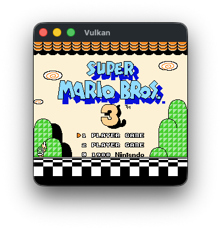
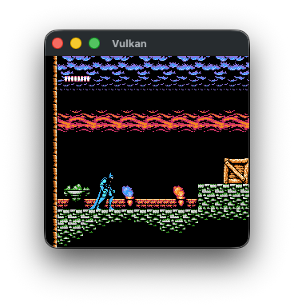

# Vulkan PPU

Implemention of retro picture processing units (just NES for now) implemented as Vulkan compute pipelines.

Everything is written in ZGAL, the shader and render graph language of my [Vulkan Wrapper](https://github.com/zach-youssef/vulkan_testing/tree/zgal) (a submodule in `external/vulkan_test`): each system's PPU and each game's program (`<game>/<game>.zgal`), whose C++ and shaders the build generates. There's no C++ of its own.

# Systems

Each system's PPU is its own (`<system>/<system>.zgal`), with a README of how it works and what it
supports. They import what they share from `common/ppu.zgal`: showing the picture on the screen
(`Show`), storing a colour into the picture (`pictureColor`) and the game frame's length.

- [NES](nes/README.md): `smb3`, `batman`

# Building and running

The games' memory dumps, taken from an emulator, are in `<game>/assets` (each system's README lists its files). Each system lists its games in `<system>/games.mk` (`GAMES += ...`), which the Makefile includes, and a new game's dumps in `<game>/assets` are committed like these (`.gitignore` ignores other `.bin` files). Building needs what the wrapper does (the Vulkan SDK, `glslc`, GLFW, GLM and Racket 8). The tools that take new dumps are in [`tools/dump`](tools/dump/README.md).

    make                       # builds build/smb3/smb3 and build/batman/batman
    build/smb3/smb3            # in a window (--help for the options)
    make test                  # captures frames 1 to 120 headless, with validation (incl. sync),
                               # and compares them with tests/approved
    make approve-screenshots   # accepts the last run's frames
    make test-tools            # tests the dump tools (tools/dump, Racket)

The games also run on the web (WebGPU), from TypeScript and WGSL the same ZGAL compiles to. That
needs Node 24 and npm as well.

    make web                   # builds build/web/smb3 and build/web/batman
    python3 -m http.server -d build/web/smb3   # then open http://localhost:8000/smb3.zgal.html
    node build/web/smb3/smb3.zgal.main.js --frames 60 --capture smb3.png   # headless, under Node
    make test-web              # captures the same frames under Node and compares them with
                               # tests/approved

# CI

GitHub Actions (`.github/workflows/ci.yml`) checks every pushed commit, not only the tip: the
commits a working branch has beyond `main`, or those a push to `main` brings (at most the newest
20). Each one is built on Ubuntu 24.04 with clang++, then runs `make test` (natively, on lavapipe,
Mesa's software Vulkan driver, with validation including synchronization validation) and `make
test-web` (under Node with Dawn, also on lavapipe), and gets a `test` commit status. The runner's
setup and the commit listing are the wrapper's actions (`external/vulkan_test/.github/actions`),
taken from the wrapper the pushed commit pins, so every commit is checked with the same setup. A
failing check uploads its captured frames and their differences as an artifact.

The setup caches the Vulkan SDK, ccache and npm's downloads. GitHub scopes caches per branch: a
branch restores only its own caches or the default branch's, and what it saves never reaches `main`.

The test jobs build and run the commits' code, so they get a read-only token and no checkout
persists its credentials (a build could plant a program that a later step runs with a token).
Two jobs that check nothing out post the statuses instead: `pending` marks each commit's `test`
check pending, and `statuses`, after every test job, posts each commit's outcome from its job's
conclusion in the run's jobs API (matched by the name `test / test <sha>`), linked to that job.
Success and failure post as they are; a cancelled, timed-out, missing or unreadable job posts
`error`, so no commit stays pending.

CI tests the pinned wrapper. A canary (`.github/workflows/canary.yml`, weekly or by hand with
`gh workflow run canary.yml`) runs the same tests on `main` against the wrapper's newest commit,
to catch breakage before the pin is bumped; nothing depends on it.

# Screnshots

